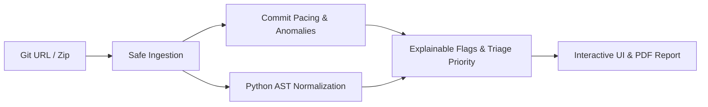

# CodeProvenance (gitAnalyser)

> **Evidence-Based Code Provenance, Commit Pacing Triage, and Structural AST Similarity Engine**  
> GitHub Repository: [https://github.com/mokshithk/gitAnalyser](https://github.com/mokshithk/gitAnalyser)

---

## 1. What It Is

**CodeProvenance** is a general-purpose developer and academic triage tool designed for professors, teaching assistants, technical recruiters, and engineering leads. Users submit a public or private Git URL (or an uploaded zip archive) and receive an evidence-based analysis of **how** the code was constructed and whether it structurally resembles other repositories.

### Important Disclaimer
> **Notice:** CodeProvenance produces evidentiary signals and triage metrics intended exclusively for human review. It **never claims to prove cheating or plagiarism**. Authentic development practices (such as squashing feature branches before merge, offline prototyping, or integrating standard boilerplate) can trigger similar statistical patterns.

---

## 2. How It Works



1. **Safe Ingestion:** Clones full history with the Git CLI (not GitHub API, avoiding rate limits) with strict size (250 MB) and timeout (60s) limits. For zip archives, it performs zip-bomb (ratio <= 100:1) and path traversal checks. It detects whether `.git` exists, switching automatically between **Full History Mode** and **Similarity-Only Mode**.
2. **Commit History Telemetry:** Computes commits per day/week, longest gaps, last-minute rush indicators, codebase share per commit, burst changes (*"large change in a short time"*), author vs committer timestamp mismatches, and artificially regular commit intervals (scripted replay detection).
3. **Python AST Normalization & Subtree Fingerprinting:** Parses `.py` files using Python's standard `ast` module, strips docstrings, removes trivial boilerplate (`__init__`, getters/setters), canonicalizes user identifiers (`var_0`, `arg_0`), and computes SHA-256 structural subtree fingerprints and node n-gram similarity.
4. **Reference Corpus & Baseline Comparison:** Compares submitted repositories against an indexed reference corpus, previous database submissions, and batch peers. Also runs a plain text-diff baseline checker (`difflib.SequenceMatcher`).
5. **Explainable Flags & Priority Ranking:** Eliminates speculative "authenticity scores". Instead, flags contain concrete evidence, suggested Viva interview questions, user review status toggle (`open`, `reviewed`, `dismissed`), and an overall Review Priority ranking (`HIGH`, `MEDIUM`, `LOW`, `CLEAN`).
6. **Pure-Python PDF Reports:** Exports complete triage reports via ReportLab with mandatory disclaimer, telemetry tables, flag breakdowns, and limitations.

---

## 3. Environment & Prerequisites (Windows Setup on D: Drive)

All caches, temporary files, virtual environments, and node modules are strictly isolated to `D:\gitAnalyserProject`.

### Prerequisites
- **Python 3.13+** (Installed on Windows)
- **Node.js v20+** & **npm**
- **Git for Windows**
- **XAMPP (MySQL / MariaDB)**

---

## 4. How to Start MySQL in XAMPP

1. Open the **XAMPP Control Panel** (`d:\xampp2\xampp-control.exe` or `C:\xampp\xampp-control.exe`).
2. Click **Start** on the **MySQL** module.
3. Verify that the port is `3306` (Status should show *Running* with a green background).
4. CodeProvenance connects to the dedicated database `codeprovenance` using the credentials in `.env`:
   - Host: `127.0.0.1:3306`
   - User: `cp_user`
   - Database: `codeprovenance`

*(The schema and credentials were initialized via `backend/db/init_db.sql` and `backend/db/schema.sql`).*

---

## 5. Quickstart & Running the Application

### Step 1: Initialize Environment Variables
In **every new PowerShell terminal**, execute the environment setup script to ensure all temp and cache operations stay on `D:`:
```powershell
. "D:\gitAnalyserProject\setup_env.ps1"
```

### Step 2: Run the Backend (FastAPI)
```powershell
. "D:\gitAnalyserProject\setup_env.ps1"
& "D:\gitAnalyserProject\.venv\Scripts\python.exe" -m uvicorn backend.main:app --host 127.0.0.1 --port 8000 --reload
```
The FastAPI backend will be available at:
- API Server: [http://127.0.0.1:8000](http://127.0.0.1:8000)
- Swagger Interactive Docs: [http://127.0.0.1:8000/docs](http://127.0.0.1:8000/docs)
- Health Check: [http://127.0.0.1:8000/api/health](http://127.0.0.1:8000/api/health)

### Step 3: Run the Frontend (React + Vite)
In a second terminal:
```powershell
. "D:\gitAnalyserProject\setup_env.ps1"
cd "D:\gitAnalyserProject\frontend"
npm run dev
```
The user interface will be live at:
- Web Application: [http://localhost:5173](http://localhost:5173)

---

## 6. How to Run the Evaluation Benchmark

The evaluation dataset contains 12 labeled test repositories across 4 categories (`genuine_history`, `direct_copy`, `renamed_restructured_copy`, `fake_history`).

To regenerate the dataset and run the benchmark comparing CodeProvenance against the plain text-diff baseline:
```powershell
. "D:\gitAnalyserProject\setup_env.ps1"

# 1. (Optional) Recreate synthetic test repositories
& "D:\gitAnalyserProject\.venv\Scripts\python.exe" "D:\gitAnalyserProject\eval\dataset_generator.py"

# 2. Run benchmark and produce eval\RESULTS.md
& "D:\gitAnalyserProject\.venv\Scripts\python.exe" "D:\gitAnalyserProject\eval\benchmark.py"
```

### Evaluation Summary
| Metric | CodeProvenance (AST + Pacing) | Plain Text-Diff Baseline |
| :--- | :---: | :---: |
| **Precision** | **100.0%** | 100.0% |
| **Recall (Sensitivity)** | **100.0%** | **33.3%** |
| **False Positive Rate (FPR)** | **0.0%** | 0.0% |
| **F1-Score** | **1.0000** | **0.5000** |

*Read the full error analysis and breakdown in [`eval/RESULTS.md`](eval/RESULTS.md).*

---

## 7. How to Run the Automated Test Suite

Run all 19 unit, integration, and Playwright browser tests:
```powershell
. "D:\gitAnalyserProject\setup_env.ps1"
& "D:\gitAnalyserProject\.venv\Scripts\pytest.exe" -v "D:\gitAnalyserProject\tests\"
```
All unit tests (`test_auth.py`, `test_ingestion.py`, `test_commits.py`, `test_similarity.py`, `test_flags.py`) and browser automation tests (`test_ui_flow.py`) run in headless mode.

---

## 8. Managing the Reference Corpus

To index an open-source repository into the persistent reference corpus:
```powershell
. "D:\gitAnalyserProject\setup_env.ps1"
& "D:\gitAnalyserProject\.venv\Scripts\python.exe" "backend\scripts\add_corpus.py" https://github.com/owner/repository.git
```

---

## 9. Known Limitations

1. **Thin or Squashed Git History:** When developers squash commits before merging, intermediate incremental history is lost, appearing as a single large addition.
2. **No Git Telemetry in Raw Archives:** Zip uploads without a `.git` directory operate strictly in similarity-only mode with zero commit telemetry.
3. **Reference Corpus Coverage:** Similarity matching is bounded by repositories indexed in the reference database or submitted in previous batches.
4. **Timestamp Forgeability:** Git commit and author timestamps can be manipulated using environment variables (`GIT_COMMITTER_DATE`) or interactive rebasing.
5. **Language AST Scope:** AST structural normalization is currently implemented for Python. Non-Python languages are analyzed via line-level comparisons and commit telemetry.

---

## 10. Future Work

- **Multi-Language AST Normalization:** Implement Tree-sitter parsers to support Java, C/C++, TypeScript, and Go.
- **LMS Integration:** Turnkey integration with Canvas, Moodle, and Blackboard submission APIs.
- **Code Style Clustering:** Detect stylistic anomalies across commits (e.g. abrupt shifts between indentation styles, variable naming conventions, or bracket placements).
- **Program Dependency Graphs (PDG):** Graph-based semantic isomorphism to catch deeply restructured algorithms (e.g., recursive &harr; iterative conversions).
- **Distributed Worker Queues:** Celery/Redis integration for multi-worker scaling across university clusters.
- **Public Open-Source Index:** Scaled indexing of popular public homework templates and standard algorithms.
