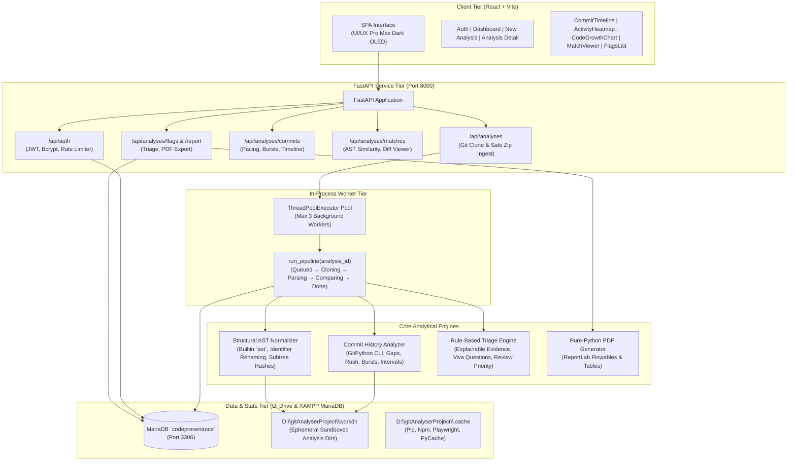
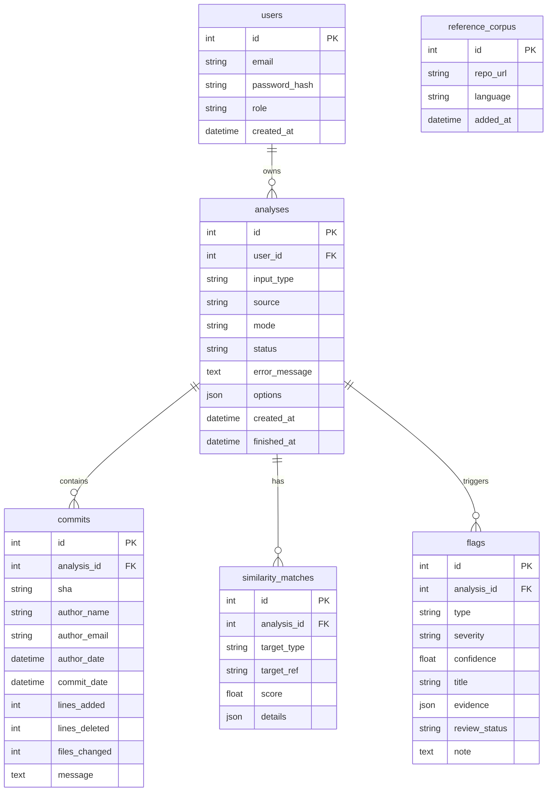

# CodeProvenance &mdash; Architectural Design & Knowledge Graph

This document details the layered architecture, module relationships, and data flow of **CodeProvenance** (GitHub: `gitAnalyser`).

---

## 1. High-Level Architecture Diagram

---

## 2. Core Modules & Responsibilities

| Module | Location | Primary Responsibility |
| :--- | :--- | :--- |
| **Authentication & Security** | `backend/auth/` | Bcrypt password hashing, JWT bearer token issuance/validation, and scan rate limiting per user. |
| **Ingestion & Safety** | `backend/ingestion/` | Git CLI shallow/full history cloning, access token isolation, zip bomb prevention, path traversal defense, and workdir cleanup. |
| **Commit Telemetry** | `backend/analysis/` | Topological git commit graph parsing, lines added/deleted, codebase share calculation, burst pace anomaly detection, and activity heatmap. |
| **Structural AST Similarity** | `backend/similarity/` | Python AST parsing, docstring stripping, variable/argument normalization to canonical placeholders, exact subtree hashing, and text-diff baseline. |
| **Explainable Flags & Triage** | `backend/flags/` | Evaluates rule-based signals, produces concrete evidence summaries, generates suggested interview questions, and exports pure-Python PDF reports. |
| **Frontend UI/UX** | `frontend/` | React 18 + Vite SPA styled with UI/UX Pro Max technical dark palette, Chart.js visualizations, and side-by-side match viewer. |

---

## 3. Database Entity Relationship Diagram

