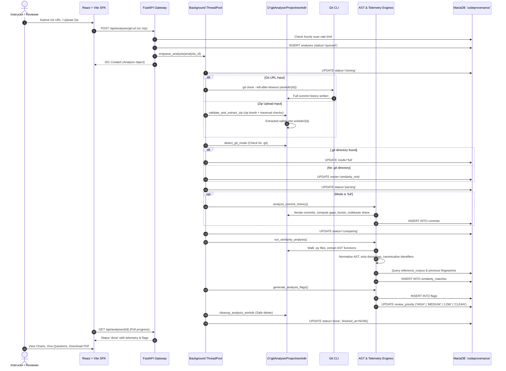
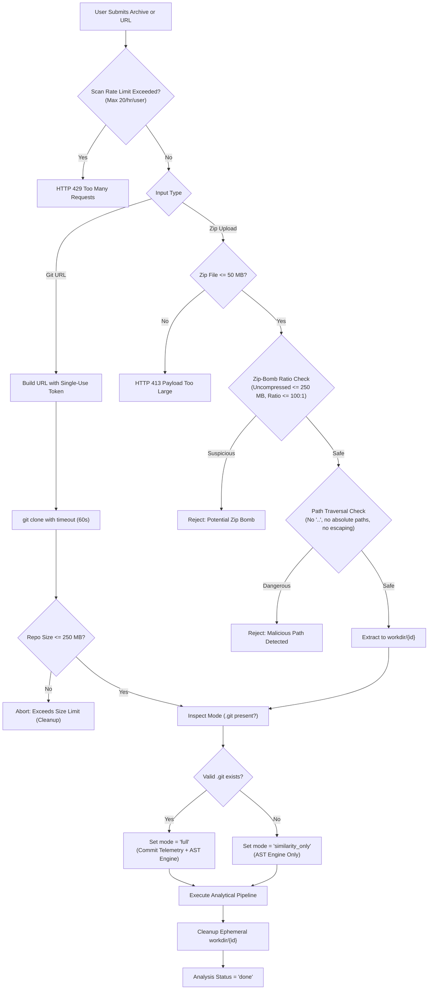

# CodeProvenance &mdash; Ingestion & Triage Pipeline Workflow

This document illustrates the end-to-end ingestion pipeline, safety boundaries, and analytical state machine implemented in `backend/ingestion/worker.py`.

---

## 1. End-to-End Pipeline Sequence Diagram

---

## 2. Ingestion Safety & Threat Mitigation Rules

